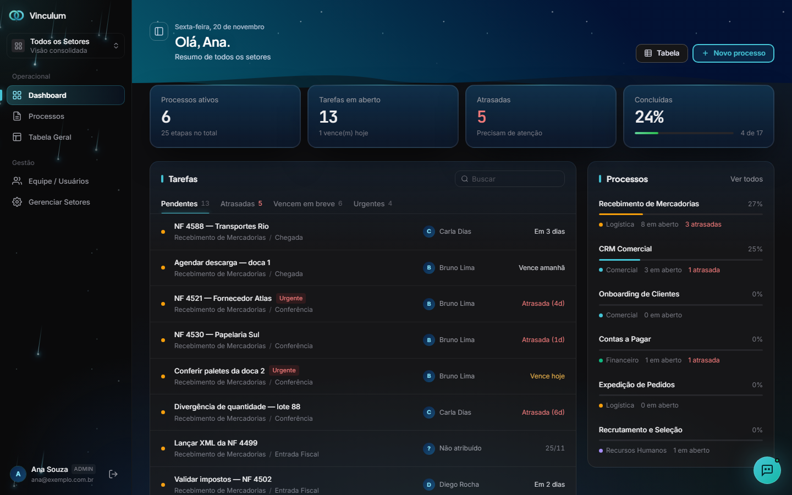
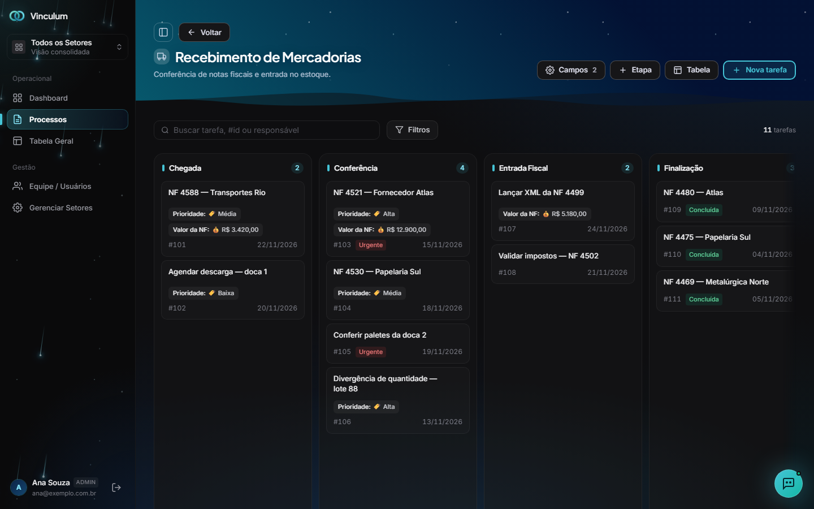
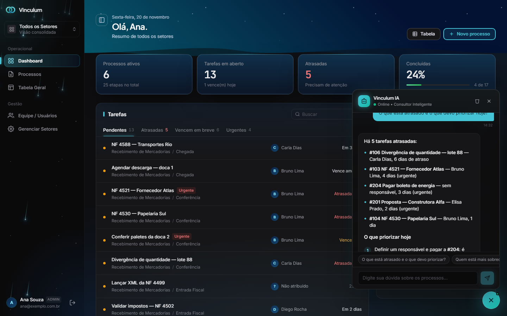
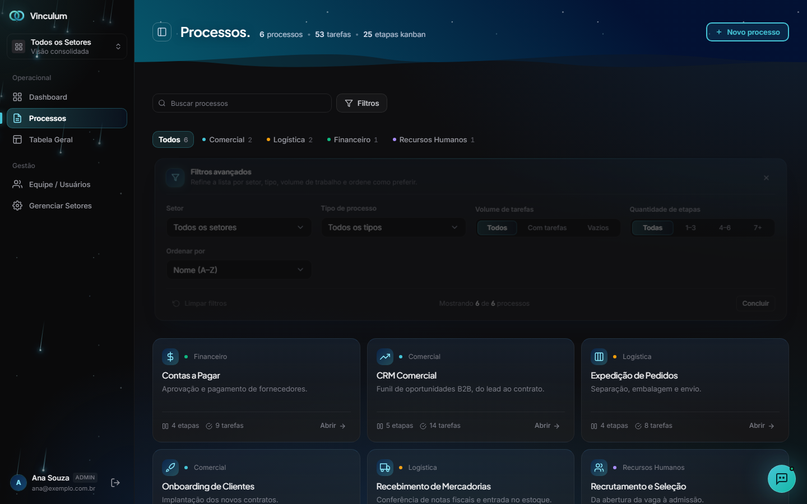
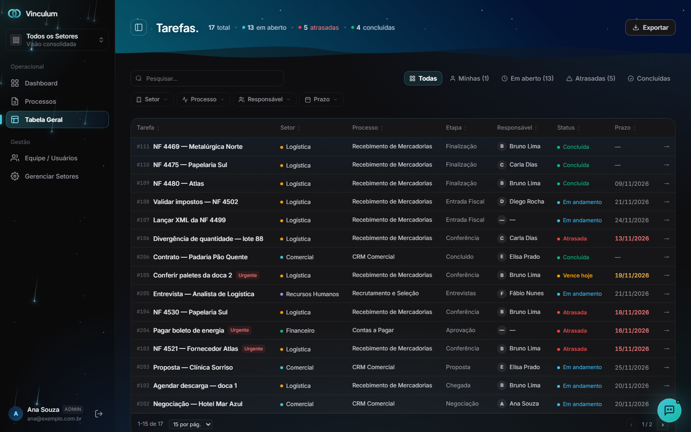
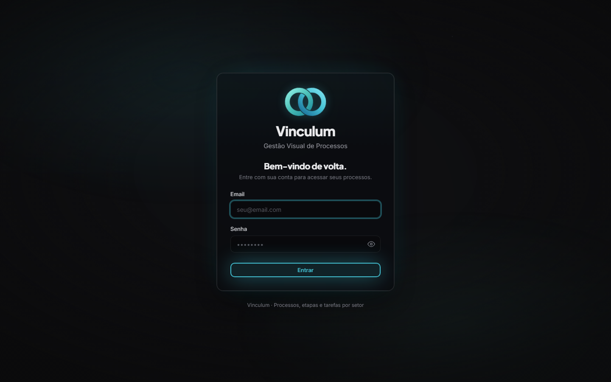
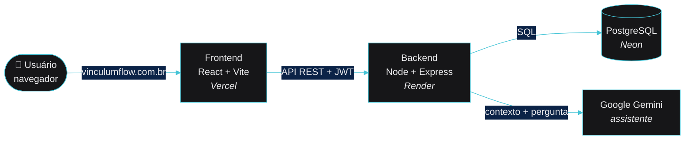

<div align="center">

<a href="https://vinculumflow.com.br">
  
</a>

<br>

[](https://vinculumflow.com.br)
&nbsp;
[](https://vinculumflow.com.br)
&nbsp;
[](#-autoria)


-161618?style=flat-square&logo=postgresql&logoColor=45c4d6)


**[Sobre](#-sobre)** · **[Telas](#-telas)** · **[Funcionalidades](#-funcionalidades)** · **[Acesso](#-como-funciona-o-acesso)** · **[Assistente I.A.](#-vinculum-ia)** · **[Rodar localmente](#-rodando-localmente)** · **[Publicação](#-publicação)**

</div>

<br>

## ◆ Sobre

O **Vinculum** é uma plataforma de **gestão visual de processos** para pequenas e médias empresas.
Ele troca planilhas soltas e combinados de WhatsApp por **quadros Kanban organizados por setor**: cada processo da empresa (recebimento de mercadorias, vendas, contas a pagar, recrutamento…) vira um quadro com etapas, e cada demanda vira uma tarefa com **responsável, prazo e campos próprios do negócio**.

O gestor enxerga a operação inteira num painel — o que está atrasado, quem está sobrecarregado, onde o trabalho trava — e um **assistente com inteligência artificial** responde perguntas sobre esses dados em linguagem natural.

> **Para quem é:** equipes operacionais e gestores de PMEs, sem conhecimento técnico.
> **Endereço oficial:** **[vinculumflow.com.br](https://vinculumflow.com.br)**

<br>

## ◆ Telas

<table>
  <tr>
    <td width="50%"><br><sub><b>Dashboard</b> — indicadores, tarefas por prazo e andamento dos processos</sub></td>
    <td width="50%"><br><sub><b>Quadro Kanban</b> — etapas do processo, arrastar e soltar, campos personalizados</sub></td>
  </tr>
  <tr>
    <td width="50%"><br><sub><b>Vinculum IA</b> — perguntas em linguagem natural sobre os dados reais</sub></td>
    <td width="50%"><br><sub><b>Processos</b> — busca, abas por setor e filtros avançados</sub></td>
  </tr>
  <tr>
    <td width="50%"><br><sub><b>Tabela Geral</b> — todas as tarefas, filtros e exportação CSV</sub></td>
    <td width="50%"><br><sub><b>Login</b> — acesso fechado, contas criadas pela empresa</sub></td>
  </tr>
</table>

<sub>As telas usam uma empresa fictícia de demonstração.</sub>

<br>

## ◆ Funcionalidades

**Processos e Kanban**
- Processos organizados por **setor** (Comercial, Logística, Financeiro…), cada um com seu quadro Kanban.
- Etapas livres: criar, renomear, reordenar arrastando o cabeçalho e excluir.
- Tarefas com responsável, prazo, marcação de urgente e descrição; **arrastar e soltar** entre etapas (mouse, toque longo no celular ou teclado).
- **Campos personalizados** por processo — texto, número, valor em R$, data, lista de opções e sim/não — que podem ser **obrigatórios na criação ou ao entrar numa etapa** específica.
- Histórico de cada tarefa: quem moveu, editou e quando.

**Acompanhamento**
- **Dashboard** com processos ativos, tarefas em aberto, atrasadas e taxa de conclusão; abas Pendentes, Atrasadas, Vencem em breve e Urgentes.
- **Tabela Geral** com busca, visões rápidas, filtros por setor/processo/responsável/prazo, ordenação e **exportação CSV**.
- **Filtros avançados** em Processos, no Kanban (responsável, prazo, urgência, situação, período e campos do processo) e na Equipe.

**Equipe e acesso**
- Perfis **Administrador** e **Colaborador**; cada colaborador vê apenas os setores a que tem acesso.
- Gestão de equipe e de setores (nome, descrição e cor) feita pelo administrador.

**Vinculum IA**
- Assistente que conhece os dados da empresa e a própria plataforma (detalhes [abaixo](#-vinculum-ia)).

<br>

## ◆ Como funciona o acesso

O Vinculum é um **sistema fechado**: não existe cadastro público. Quem cria as contas é o administrador da empresa.

```
 1. A empresa recebe a conta de administrador (gestor)
        │
 2. O gestor cria os setores  ─────────►  Logística · Comercial · Financeiro …
        │
 3. O gestor cadastra a equipe  ───────►  Equipe e Acessos → Novo Colaborador
        │                                  (perfil + setores de cada pessoa)
 4. O gestor monta os processos  ──────►  etapas do Kanban + campos personalizados
        │
 5. Cada colaborador entra e vê só os processos dos seus setores
```

> **Uma empresa por instalação.** Hoje cada instalação (site + banco de dados) atende uma empresa. Para várias empresas no mesmo endereço, seria preciso separar os dados por empresa (multiempresa/SaaS).

### O site publicado é restrito à banca avaliadora

O endereço **[vinculumflow.com.br](https://vinculumflow.com.br)** é uma **instalação de demonstração deste TCC**, com uma empresa fictícia, e **o acesso a ela está disponível somente para a banca avaliadora**. Os motivos:

- **É uma vitrine acadêmica, não um serviço aberto** — existe para a avaliação do trabalho.
- **Uma empresa por instalação** — como os dados não são separados por empresa, abrir o acesso faria todos os visitantes compartilharem (e alterarem) os mesmos dados.
- **Recursos gratuitos e limitados** — hospedagem, banco de dados e a cota do assistente com I.A. rodam em planos gratuitos, dimensionados para a avaliação.

As credenciais da banca são entregues no Manual do Usuário e **não são publicadas aqui**.

### Quer usar o Vinculum?

Monte a **sua própria instalação**: baixe o projeto, crie o seu banco de dados e as tabelas (esquema), configure as variáveis e rode o sistema — no seu computador ou na sua hospedagem. O passo a passo completo está em **[Rodando localmente](#-rodando-localmente)** e **[Publicação](#-publicação)**. Na sua instalação, você define as senhas e é o administrador da sua empresa.

<br>

## ◆ Vinculum IA

O botão redondo no canto inferior direito abre o assistente. Ele responde com base nos **dados reais** que o usuário logado pode ver:

| Pergunte coisas como | O que ele faz |
|---|---|
| *"O que está atrasado e o que devo priorizar hoje?"* | Lista as tarefas vencidas e sugere a ordem de ataque |
| *"Quem está mais sobrecarregado?"* | Compara a carga de trabalho da equipe |
| *"Onde estão os gargalos?"* | Aponta etapas acumuladas e tarefas sem responsável |
| *"Monte um fluxo para uma clínica odontológica"* | Sugere etapas, campos personalizados e regras de obrigatoriedade |
| *"Como exporto as tarefas para o Excel?"* | Explica o passo a passo com os nomes certos dos botões |

**Como funciona por dentro**
- Usa o **Google Gemini** (plano gratuito) — ou o **Claude**, se configurado. A chave fica **só no servidor**; o usuário não vê nem configura nada.
- A cada pergunta, o servidor envia ao modelo um resumo dos setores, processos, etapas, responsáveis e tarefas atrasadas/próximas **visíveis para aquele usuário**, mais o histórico da conversa.
- Escolhe automaticamente um modelo disponível e troca de modelo se um estiver sobrecarregado.
- **Proteções:** exige login, limita perguntas por pessoa (10/min e 150/dia) e, se a I.A. estiver indisponível, responde em modo simplificado avisando o usuário.
- Instruído a **não inventar dados**: se a informação não existe, diz onde encontrá-la.

<br>

## ◆ Tecnologias

| Camada | Tecnologias |
|---|---|
| **Frontend** | React 18 · Vite 5 · React Router · Framer Motion · CSS Modules · Axios |
| **Backend** | Node.js · Express · JWT (`jsonwebtoken`) · `bcryptjs` |
| **Banco de dados** | PostgreSQL (Neon) — ou SQL Server, sem mudar o código |
| **Inteligência artificial** | Google Gemini (padrão) · Anthropic Claude (opcional) |
| **Hospedagem** | Vercel (frontend) · Render (backend) · Neon (banco) · Registro.br (domínio) |



<br>

## ◆ Rodando localmente

**Pré-requisitos:** Node.js 18+ e um banco PostgreSQL (o plano gratuito do [Neon](https://neon.tech) serve) ou SQL Server.

**1. Clonar e instalar**
```bash
git clone https://github.com/Miguel-Manso/Vinculum.git
cd Vinculum
npm install --prefix backend
npm install --prefix frontend
```

**2. Configurar o backend** — copie `backend/.env.example` para `backend/.env` e preencha ao menos `DATABASE_URL` e `JWT_SECRET` (veja [variáveis](#variáveis-de-ambiente)).

**3. Criar as tabelas e a empresa de demonstração** (dentro da pasta `backend`, para os scripts lerem o `backend/.env`)
```bash
cd backend
node src/scripts/setup_neon.js            # cria as tabelas (PostgreSQL)
```
```powershell
# PowerShell — escolha a senha das contas de demonstração
$env:SENHA_DEMO="<escolha uma senha forte>"; node src/scripts/popular_banco.js
```
```bash
# Linux / macOS
SENHA_DEMO="<escolha uma senha forte>" node src/scripts/popular_banco.js
cd ..
```
O script cria setores, processos e tarefas de exemplo, além de uma conta de **administrador** e contas de **colaboradores**, todas com a senha que você definiu em `SENHA_DEMO`. Ao terminar, ele **mostra no terminal os e-mails criados** para você entrar. Ele não apaga nada e pode ser executado de novo.

> ⚠️ O `banco_postgres.sql` cria um administrador inicial com uma senha padrão que está no código. O `popular_banco.js` troca automaticamente qualquer senha padrão pela sua `SENHA_DEMO` — rode-o antes de publicar.

**4. Iniciar**
```bash
npm run dev --prefix backend     # API em http://localhost:3000
npm run dev --prefix frontend    # site em http://localhost:5173
```

### Variáveis de ambiente

<details>
<summary><b>Backend</b> (<code>backend/.env</code> · no Render: <i>Environment</i>)</summary>

| Variável | Obrigatória | Descrição |
|---|---|---|
| `DATABASE_URL` | sim* | URL do PostgreSQL (Neon). *Ou use `DB_SERVER`, `DB_PORT`, `DB_DATABASE`, `DB_USER`, `DB_PASSWORD` para SQL Server |
| `JWT_SECRET` | sim | Chave dos logins. Em produção: **≥ 32 caracteres, aleatória e privada** — o servidor não inicia com chave fraca |
| `JWT_EXPIRES_IN` | não | Duração do login (padrão `8h`) |
| `PORT` | não | Porta da API (padrão `3000`) |
| `GEMINI_API_KEY` | não | Chave do Gemini ([AI Studio](https://aistudio.google.com)). Sem ela, o chat usa o modo básico |
| `GEMINI_MODEL` | não | Força um modelo (padrão: escolha automática) |
| `ANTHROPIC_API_KEY` / `ANTHROPIC_MODEL` | não | Usa o Claude no lugar do Gemini |
| `IA_PROVEDOR` | não | `gemini` ou `anthropic`, se as duas chaves existirem |
| `CHAT_LIMITE_MINUTO` / `CHAT_LIMITE_DIA` | não | Limite de perguntas por usuário (padrão `10` / `150`) |
| `CORS_ORIGINS` | não | Sites extras que podem chamar a API (o domínio oficial, a Vercel e localhost já são liberados) |
| `APP_TZ` | não | Fuso horário (padrão `America/Sao_Paulo`) |

Gerar um `JWT_SECRET`: `node -e "console.log(require('crypto').randomBytes(48).toString('hex'))"`
</details>

<details>
<summary><b>Frontend</b> (<code>frontend/.env</code> · na Vercel: <i>Environment Variables</i>)</summary>

| Variável | Descrição |
|---|---|
| `VITE_API_URL` | Endereço da API, ex.: `http://localhost:3000/api` (local) ou a URL do Render (produção) |
</details>

<br>

## ◆ Publicação

| Parte | Serviço | Observações |
|---|---|---|
| Frontend | **Vercel** | Publica sozinho a cada push na `master`. `VITE_API_URL` aponta para o backend |
| Backend | **Render** (plano gratuito) | Publica sozinho a cada push. Variáveis em *Environment* |
| Banco | **Neon** (PostgreSQL gratuito) | Tabelas criadas com `setup_neon.js` |
| Domínio | **Registro.br** | `vinculumflow.com.br` apontado para a Vercel |
| Backend acordado | **GitHub Actions** | [`manter-backend-acordado.yml`](.github/workflows/manter-backend-acordado.yml) chama `/api/health` a cada 10 min, para o plano gratuito do Render não "dormir" |

<br>

## ◆ Segurança

- **Login com JWT**; senhas guardadas com `bcrypt`. Em produção o servidor exige um `JWT_SECRET` forte.
- **Sem cadastro público** — contas são criadas pelo administrador.
- **Acesso por setor**: colaboradores só veem processos, tarefas e colegas dos seus setores.
- **CORS restrito** ao site oficial.
- **Chaves e senhas só em variáveis de ambiente** — o `.env` não vai para o GitHub.
- **Assistente** com login obrigatório e limite de uso por pessoa.

<br>

## ◆ Estrutura do projeto

```
Vinculum/
├── frontend/                 # React + Vite
│   └── src/
│       ├── pages/            # Dashboard, Processos, Fluxo (Kanban), Tarefa, Tabela, Usuários, Login
│       ├── components/       # Sidebar, KanbanBoard, FilterPanel, Chatbot, Modal, Logo…
│       ├── context/          # login, setor ativo e sidebar
│       └── styles/           # primitivas visuais compartilhadas (ui.module.css)
├── backend/                  # Node + Express
│   └── src/
│       ├── routes/           # auth, processos, etapas, tarefas, campos, usuários, setores, chatbot…
│       ├── controllers/      # regras de negócio (inclui o Vinculum IA)
│       ├── services/         # integração com o modelo de linguagem (Gemini / Claude)
│       ├── config/           # banco de dados e segurança
│       └── scripts/          # setup_neon.js, popular_banco.js
├── banco_postgres.sql        # estrutura do banco (PostgreSQL)
├── banco.sql                 # estrutura do banco (SQL Server)
├── DESIGN.md                 # sistema visual (cores, tipografia, componentes)
└── docs/                     # banner e capturas de tela deste README
```

<br>

## ◆ Autoria

Trabalho de Conclusão de Curso desenvolvido por:

<table>
  <tr>
    <td align="center" width="180">
      <a href="https://github.com/Miguel-Manso"><br><b>Miguel Manso</b></a><br>
      <sub><a href="https://github.com/Miguel-Manso">@Miguel-Manso</a></sub>
    </td>
    <td align="center" width="180">
      <a href="https://github.com/PabloLdS"><br><b>Pablo Lemes da Silva</b></a><br>
      <sub><a href="https://github.com/PabloLdS">@PabloLdS</a></sub>
    </td>
  </tr>
</table>

<div align="center">
<br>
<a href="https://vinculumflow.com.br"></a>
</div>
